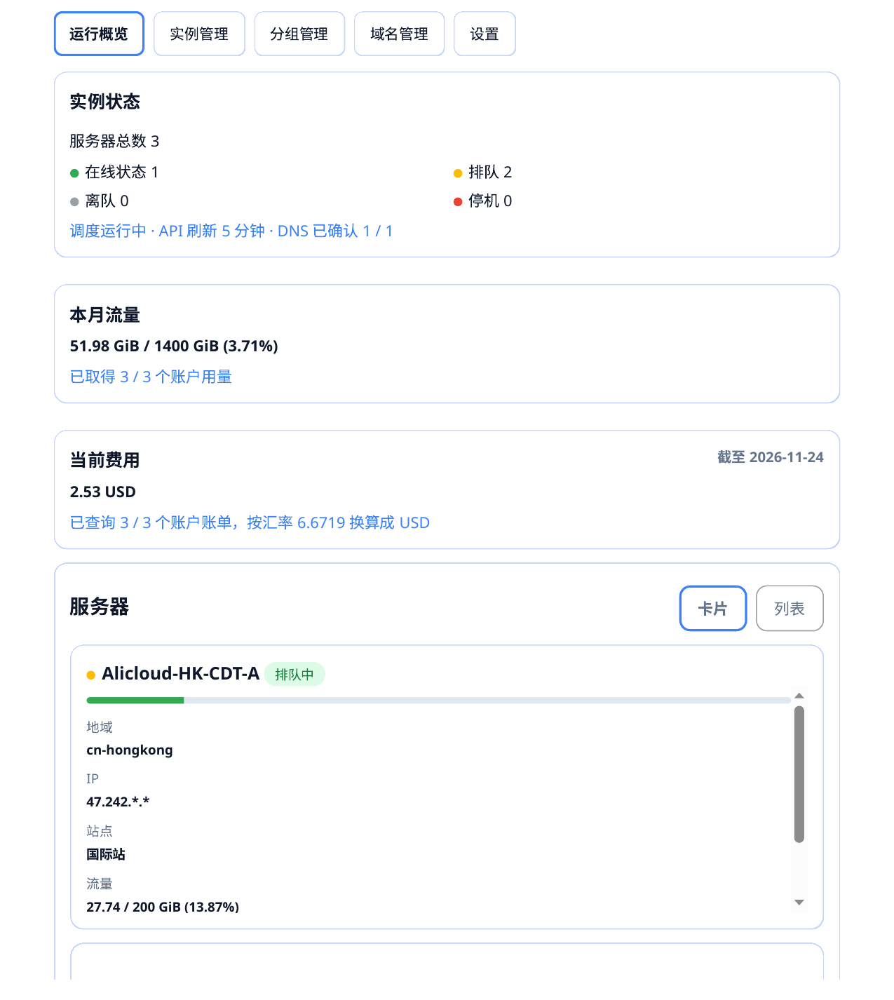
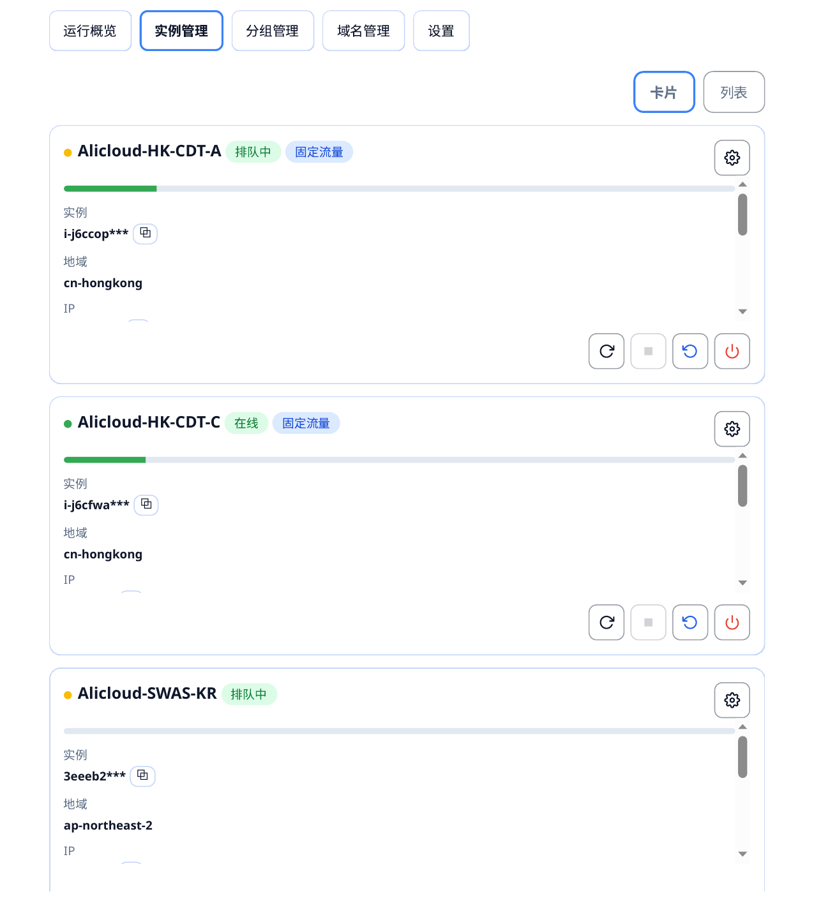
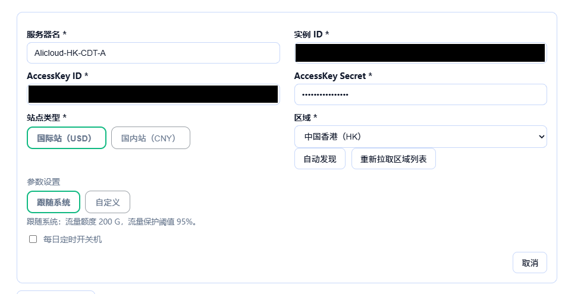
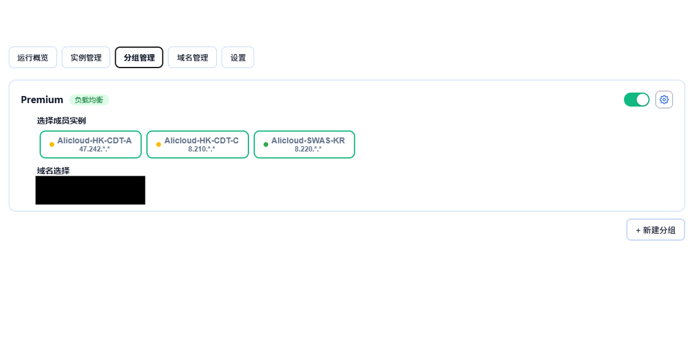
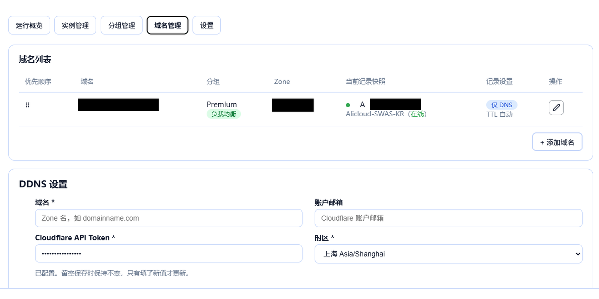
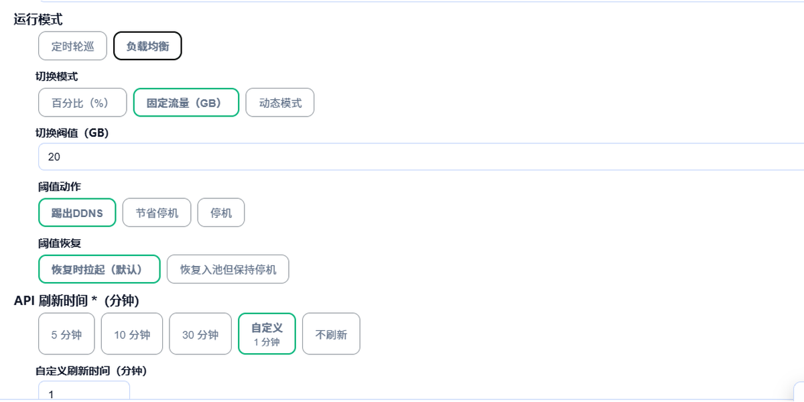
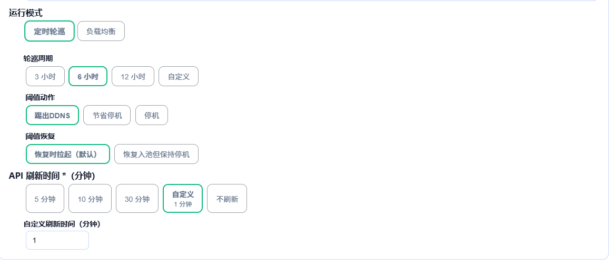

# Alicloud_ECS_CDTPanel

阿里云 ECS / CDT 流量调度面板：多账户流量监控、抢占式实例保活、Cloudflare DDNS 自动切换、Telegram 机器人控制、一键更换 EIP。

## 项目介绍

Alicloud_ECS_CDTPanel 是一个面向阿里云 ECS + CDT（云数据传输）用户的调度控制台，用来解决“多台按流量计费的服务器之间，域名总是指向最划算的那一台”这个问题：

- 每台实例都有月度流量额度（默认 200 G），用超了就贵、被限速；
- 面板实时监控每台实例的流量用量、费用和在线状态，按分组把域名解析到当前剩余流量最多的实例；
- 实例流量接近上限时自动踢出分配池、切换 DNS，实例停机时自动拉起，全部无人可用时切到备用地址。

技术栈：单进程 Python / FastAPI + SQLite（WAL），前端 React 18 + TypeScript + Vite，Docker 一键部署。数据存在 `cdt.db`，AccessKey Secret 用 `master.key` 加密保存，两者必须一起备份。

## 部署方式

### 一键部署（推荐）

```bash
curl -fsSL https://raw.githubusercontent.com/gugetang/Alicloud_ECS_CDTPanel/main/install.sh | bash
```

脚本会先检查 Docker（没有就先装）、克隆仓库到 `/opt/docker/alicloud_ECS_CDT`、拉取 GHCR 镜像并 `docker compose up -d`，再轮询 `http://127.0.0.1:1999/api/health` 最多 60 秒。

```bash
# 改项目目录
curl -fsSL https://raw.githubusercontent.com/gugetang/Alicloud_ECS_CDTPanel/main/install.sh | DIR=/srv/cdt bash
# 升级：重跑同一条命令
curl -fsSL https://raw.githubusercontent.com/gugetang/Alicloud_ECS_CDTPanel/main/install.sh | bash
# 卸载（会二次确认是否删数据）
curl -fsSL https://raw.githubusercontent.com/gugetang/Alicloud_ECS_CDTPanel/main/install.sh | UNINSTALL=1 bash
```

### Docker Compose 部署

```bash
git clone https://github.com/gugetang/Alicloud_ECS_CDTPanel.git
cd Alicloud_ECS_CDTPanel
docker compose pull
docker compose up -d
# 查看日志 / 停止
docker compose logs -f Alicloud_ECS_CDTPanel
docker compose down
```

`docker-compose.yml`（精简版，只拉 GHCR 镜像，不本地构建）：

```yaml
services:
  Alicloud_ECS_CDTPanel:
    image: ghcr.io/gugetang/alicloud_ecs_cdtpanel:latest
    container_name: Alicloud_ECS_CDTPanel
    restart: unless-stopped
    init: true
    ports:
      - "1999:1999"
    environment:
      TZ: Asia/Shanghai
      CDT_DATA_DIR: /data
      CDT_PROXY_ONLY: "1"
    volumes:
      - /opt/docker/cdt-alicloud_ecs_cdtpanel:/data
      # 在线更新用：面板通过 Docker socket 拉镜像并重建自身容器；没有这行，
      # 面板会报“未检测到 Docker socket，无法在线更新”。
      - /var/run/docker.sock:/var/run/docker.sock
```

镜像由 GitHub Actions 自动构建并推送到 GHCR：`latest` 永远等于已发布版本（只在发版时更新）。新部署和更新都只拉 `latest`，拉到的就是已发布版本。升级：发版后直接 `docker compose pull && docker compose up -d`（一键部署重跑安装命令即可，脚本会 git pull 更新 compose）；面板里的“立即更新”拉的也是 latest。想试未发布代码，按提交 SHA 标签拉。

已按旧版部署（compose 里没有上面 socket 那行）的：先把这行加进 `docker-compose.yml`，再跑一次 `docker compose pull && docker compose up -d` 重建容器，之后面板里的“立即更新”才能用。

### 部署安全：IP:端口打不开，必须走反代

面板默认只接受经过反代的请求（`CDT_PROXY_ONLY=1`，compose 默认开启）：请求必须带反代转发标识头（`X-Forwarded-For` / `X-Forwarded-Proto` / `CF-Connecting-IP` 之一），浏览器直接打开服务器 IP:1999 会返回 403。本机回环始终放行，容器健康检查走 `127.0.0.1:1999` 不受影响。

反代和证书由你自己配，项目本身不申请、不续期、不管理证书，也不绑定域名。域名先解析到服务器，再按下面示例配反代（反代可以在本机，也可以是另一台服务器或 Cloudflare 这类远端反代）：

```nginx
# Nginx 示例
server {
    listen 443 ssl;
    server_name cdt.example.com;
    ssl_certificate     /etc/letsencrypt/live/cdt.example.com/fullchain.pem;
    ssl_certificate_key /etc/letsencrypt/live/cdt.example.com/privkey.pem;
    location / {
        proxy_pass http://服务器IP:1999;  # 反代在本机时改成 http://127.0.0.1:1999
        proxy_set_header Host $host;
        proxy_set_header X-Real-IP $remote_addr;
        proxy_set_header X-Forwarded-For $proxy_add_x_forwarded_for;
        proxy_set_header X-Forwarded-Proto $scheme;
    }
}
server {
    listen 80;
    server_name cdt.example.com;
    return 301 https://$host$request_uri;
}
```

注意：转发头必须透传，否则面板会把请求当成直访而 403。想再严一点，可以在服务器防火墙上只放行反代服务器的 IP 访问 1999 端口。本地直接跑（`python -m app.main`）默认不开这个限制。

### 本地运行

```bash
python3 -m venv .venv && source .venv/bin/activate
pip install -r requirements.txt
python -m app.main            # 监听 0.0.0.0:1999，数据在 ./data
# 改端口：CDT_LISTEN_PORT=8888 python -m app.main
```

首次访问先设置管理员账号和密码（至少 6 位）。`./data/cdt.db` + `./data/master.key` 必须一起备份，丢了 `master.key`，已加密的 AccessKey Secret 无法解密。

## 功能介绍

- **一键更换 EIP**：实例卡片/详情页点“更换 EIP”，自动完成：先分配新 EIP → 解绑旧 EIP → 绑定新 EIP → 带宽跟旧的保持一致 → DNS 自动刷新到新 IP → 旧 EIP 若在共享带宽包里，先移出包、再把新 EIP 加进同一个包 → 最后释放旧 EIP；中途失败自动回滚（释放新 EIP、旧 EIP 重新绑回），成功/失败都推送通知；共享带宽步骤在 DNS 切走后做，失败只告警不回滚。仅 ECS 实例可用（i- 开头），轻量服务器不支持；机器人详情页里同样可以换。
- **分组与 DDNS**：1 个分组 = 1 个 IP 池 + 最多 1 个域名。分组卡片可开关 DDNS（开关在卡片右上角，⚙ 左边）：开启时域名指向组内当前工作的实例 IP，关闭时暂停分组、域名指向 `0.0.0.0`。删除分组是卡片右下角的红色垃圾桶图标。域名用 Cloudflare Zone 名 + 账户邮箱 + API Token 管理，DNS 记录按 Zone ID / 记录 ID 精确更新，IP 不变不发请求。
- **三种切换模式**（按分组设置，不同分组可不同）：定时轮巡（夜间窗口、间隔切换、每天固定时刻）、负载均衡（按流量差值切换，百分比模式或固定流量 GB 模式）、动态模式（每隔固定时间切到剩余流量最多的服务器，默认 30 分钟，最少 30 分钟）。分组未设置时跟随全局。
- **阈值保护**：使用率 ≥ 流量保护阈值（默认 95%）时先踢出分配池、域名先切到下一台，然后按阈值动作决定是否停机：默认只踢出、不停机（`none`），也可选择普通停机（`stop`）或节省停机（`stop_charging`）。用量回落后自动恢复入池。80% 有一次阈值告警推送，低于 80% 后重新布防。
- **保活（Keepalive）**：默认拉起全部符合条件的已停机实例，不只限于当前服务或切换目标。手动停机和阈值动作停机有持久化标记，排除期内保活不拉起；下一次 API 刷新显示用量回到恢复线（保护阈值 − 2%）以下时清除标记并拉起。面板外的停机（如阿里云控制台停机）没有标记，默认拉起。
- **备用地址**：组内无可分配 VPS 时域名指向备用地址（默认 `fallback.example.xyz`，占位地址）并推送通知；有可用 VPS 时自动恢复并推送恢复通知。
- **通知推送**：支持 Telegram、邮件两个渠道，可开关的事件包括实例启动、实例停机、阈值告警、流量保护、DNS 指向变化、备用地址、排除操作、查询异常、故障恢复、面板更新（有新版本时每个版本只推一次）；每天固定时间（默认 `00:00`）推送一次每日财报，含各实例流量、费用与状态评价。
- **Telegram 机器人**：在 Telegram 卡片里开启机器人控制（默认关闭），只响应绑定的聊天 ID；命令 /start /menu /list /groups /timers /update /help。实例列表只显示名称 + 状态圆点（🟢在线/🟡排队/🔴停机/⚪离队），一行两个；点开详情页可开关机、节省停机、更换 EIP、定时任务（开关、开机/关机时间可编辑）；/update 检查新版本，有更新一键执行。
- **实例参数设置**：每台实例可跟随系统或自定义月度流量额度与保护阈值，也可单独覆盖 API 刷新时间；自定义数值有校验（额度 > 0 G，阈值 0 < % ≤ 100）。
- **账号与域名管理**：多阿里云账号（AccessKey 加密存储）、多域名；实例支持拖拽排序、改名（1–64 字符，同分组内不重名）、单台刷新 / 启动 / 重启 / 停机；状态点全站统一（绿在线、黄排队、灰跳出/未参与、红停机/离线，闪烁绿启动中、闪烁红停止中）。
- **界面**：父项字体统一 16px、子项字体统一 14px（父项比子项大一号），子项相对父项缩进 2 字符；父项只留卡片标题与全局设置的运行模式、API 刷新时间（分组卡片里组名称是唯一的父项，全部标签与小标题都是子项）；全部按钮（含顶部导航、设置子标签、设置 ⚙ 与删除图标）悬停时放大 1.08 倍；页眉增高（logo 48px、标题 32px）；页脚固定在视口底部，不跟随页面滚动，内容为“AlicloudECS_CDT © 2026 | v1.0.0”+ 项目地址 + TG（@AliLang_AgentBot）；两张列表的流量值不换行，“/”前已用量加粗；域名管理页“+ 添加域名”按钮在域名卡片右下角；登录窗口：用户名/密码框内带左侧图标（人像/锁），登录按钮与第三方登录之间有“或使用以下方式登录”分隔线，标题只留站点名（26px）。
- **登录与安全**：管理员密码登录（失败 5 次锁定 15 分钟）、WebAuthn 指纹登录、Google / GitHub OAuth 登录，会话有效期 14 天；备份与恢复（本地 JSON 导出、WebDAV 云端备份，含加密主密钥）；每天 03:00 自动清理 90 天前的日志与流量采样并做 VACUUM。
- **在线更新**：面板每小时查一次 GitHub 最新提交，有新版本时页眉出现铃铛（在语言切换前面，无消息不显示），点开看当前/最新版本与最新提交信息，点“立即更新”即拉取最新镜像并按当前容器配置原样重建、重启。更新走 Docker socket（compose 里已挂 `/var/run/docker.sock`）；首次启用须手动 `docker compose pull && docker compose up -d` 一次，之后才能在线更新。没有 socket 时面板会提示手动命令，不假装更新成功。主题风格改到页眉调色板图标下拉（退出按钮前面），主题设置卡片已删除。

### 所需权限

给 AK 挂这几个系统策略就能用（RAM 控制台直接搜名字挂上）：

- **实例状态 / 开机 / 停机 / 重启 / 查区域**：`AliyunECSFullAccess`；轻量服务器再加 `AliyunSWASOpenFullAccess`
- **读取流量**：`AliyunCDTFullAccess`
- **读取费用**：`AliyunBSSFullAccess`
- **一键更换 EIP**：`AliyunEIPFullAccess`；旧 EIP 在共享带宽包里时再加 `AliyunVPCFullAccess`

想最小权限就用自定义策略，只给这些操作：`ecs:DescribeInstances`、`ecs:StartInstance`、`ecs:StopInstance`、`ecs:RebootInstance`、`ecs:DescribeRegions`、`swas:ListInstances`、`swas:StartInstance`、`swas:StopInstance`、`swas:RebootInstance`、`cdt:ListCdtInternetTraffic`、`bss:DescribeInstanceBill`、`bss:QueryBillOverview`、`bss:QueryAccountBalance`、`vpc:DescribeEipAddresses`、`vpc:AllocateEipAddress`、`vpc:UnassociateEipAddress`、`vpc:AssociateEipAddress`、`vpc:ModifyEipAddressAttribute`、`vpc:ReleaseEipAddress`、`vpc:RemoveCommonBandwidthPackageIp`、`vpc:AddCommonBandwidthPackageIp`（后两个只在旧 EIP 在共享带宽包里时用）。

DNS 切换不走阿里云：Cloudflare API Token 要有对应 Zone 的 DNS 编辑权限。

## 图片展示

### 运行概览

实例状态、本月流量、当前费用与服务器卡片一览。



### 实例管理

查看与操作每台实例：刷新、启动、重启、停机，卡片右上角 ⚙ 改配置。



点卡片右上角 ⚙ 打开实例配置：服务器名、实例 ID、AccessKey、站点、区域、流量额度与阈值（ID 与 AccessKey 已打码）。



### 分组管理

一个分组一个 IP 池、最多绑定一个域名，按分组选切换模式。



### 域名管理

管理 Cloudflare 域名与 DDNS 设置，查看域名当前指向。



### 全局设置

流量保护阈值、轮巡周期、阈值动作与恢复、API 刷新时间等全局参数。负载均衡模式：按流量差值切换（百分比或固定流量 GB），也可切动态模式。

<table>
<tr>
<td></td>
<td></td>
</tr>
</table>

## 逻辑分析

### 调度主循环

调度器每 60 秒跑一次 DDNS 检查：用库里已有的数据重算分配并同步 DNS，不调阿里云 API；完整轮次（带 API 刷新）按 API 刷新时间走（默认 5 分钟，可选 5/10/15/30/60 分钟或自定义，单账户可覆盖，未到期的账户用库里已有数据）。暂停调度时 DDNS 检查也停。

### 流量刷新与计费缓存

每轮 API 刷新对每个账户并行查询 ECS 实例状态、CDT 流量和 BSS 账单（最多 5 并发）。BSS 账单调用有 6 小时缓存，同一账户 6 小时内不重复查账单；`DescribeInstanceBill` 必须传当月 `BillingCycle`（`YYYY-MM`），失败时回退 `QueryBillOverview`。

### 分配与切换决策

可分配的实例必须同时满足 5 个条件：参与 DDNS、流量已知、用量低于保护阈值、状态 Running 或 Stopped、在每日开机窗口内。分配时按流量使用率升序，域名分给用量最低的实例。

- **定时轮巡**：夜间窗口内每晚第一次检查切到最低（每晚仅一次）；固定时刻当天仅一次；间隔切换按上次切换锚点每 N 小时切一次，锚点持久化，重启后继续计时。
- **负载均衡**：`percent` 模式当班使用率 − 候选使用率 ≥ 阈值（默认 10%）切；`gb` 模式当班已用 GB − 候选已用 GB ≥ 阈值（默认 10 GB）切。域名无人服务时（都在排队）不受差值限制，直接分给剩余流量最多的实例。
- **动态模式**：每到动态切换间隔切到剩余流量最多的服务器，不看流量差值；切换前先拉起目标实例（如果已停机），被切走的实例不自动停机。

### 阈值踢出与恢复

使用率 ≥ 保护阈值（默认 95%）→ 先退出分配池、域名先切到下一个最低账户，**然后**才按阈值动作决定是否停机；同一账户多域名只停一次。流量或实例状态未知时保守不动，不踢出、不停机；但域名当前实例流量未知、已停机或未参与（即实际上无人服务）时，直接分给池内剩余流量最多的实例。阈值恢复动作默认 `start`：用量回到恢复线以下时拉起之前因阈值停机的实例。

### 保活排除规则

保活每轮拉起所有符合条件的已停机实例，符合条件 = 参与 DDNS、未超保护阈值、未被踢出、在每日开机窗口内、所属分组未暂停、阈值恢复动作不是 `keep_stopped`。排除两类停机：面板手动停机、阈值动作停机，排除原因持久化在 `accounts.stop_reason`（`manual` / `threshold` / `schedule`）。排除只到下一次 API 流量刷新为止：刷新显示用量回到恢复线（保护阈值 − 2%）以下时清除标记、重新加入拉起；用量仍在恢复线以上时继续排除。保活跳过被排除实例时记 `keepalive_skip` 事件，解除排除时记 `keepalive_rejoin` 事件。

### 备用地址触发条件

当一个分组内没有任何实例满足 5 个可分配条件时，域名指向备用地址并推送“备用地址已启用”；一旦有实例重新满足条件，面板自动把域名恢复到该实例并推送“备用地址已恢复”。

## 项目赞助

[](https://www.alibabacloud.com) [](https://www.muse.ai)

## 贡献者

- [ Alilang](https://github.com/gugetang)
- [ Muse AI](https://www.muse.ai)
